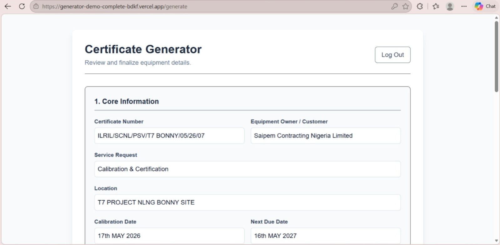
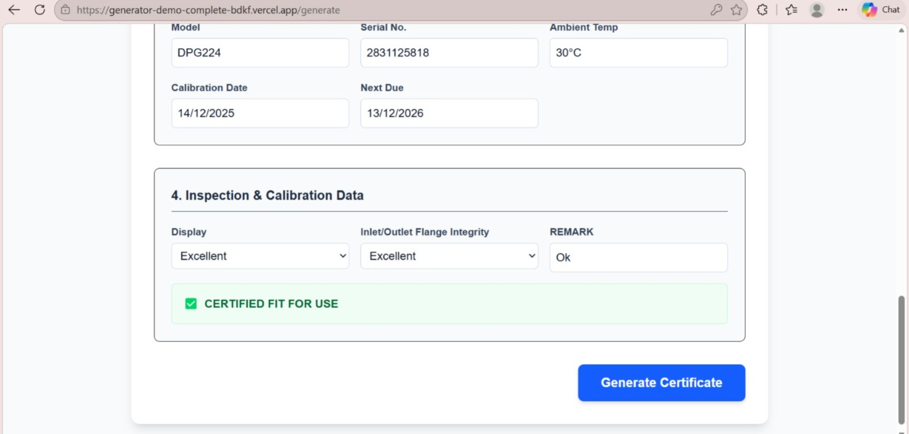
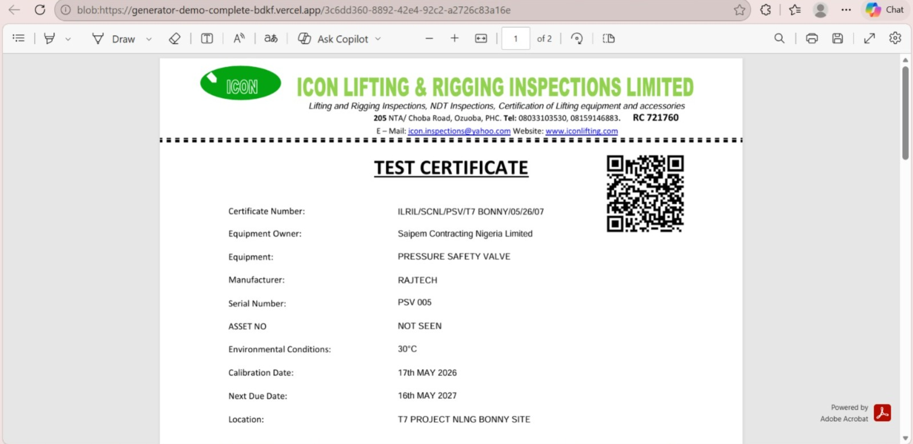
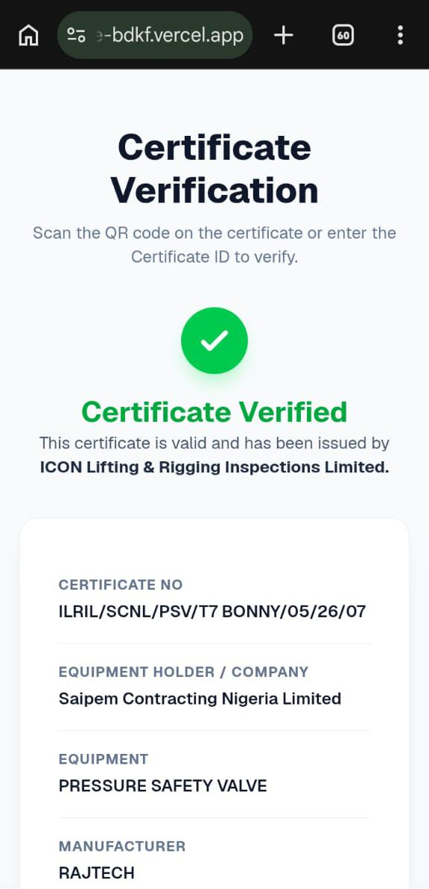

# Digital Certificate Generator & Verification system

A full-stack, cloud-deployed web application that generates digital certificates with embedded QR codes, allowing for instant credential verification via smartphone scanning against a live database.

## 🚀 Live Demo
* **Frontend (Generator):** https://generator-demo-complete-bdkf.vercel.app/
* **Backend API:** https://generator-demo-complete-backend.onrender.com

## ✨ Features
* **Dynamic PDF Generation:** Stamps user data directly onto a certificate template using `pdf-lib`.

* **Embedded QR Codes:** Automatically generates and embeds a unique QR code into the PDF.

* **Instant Verification:** Scanning the QR code opens a mobile-responsive verification page that fetches live credential data.

* **Cloud-Ready Environment:** Fully configured with environment variables to seamlessly switch between local development and production.

## 🛠️ Tech Stack
**Frontend (Client)**
* Next.js (React)
* TypeScript
* `pdf-lib` (PDF manipulation)
* Hosted on **Vercel**

**Backend (Server)**
* Node.js
* Express.js
* `cors` (Cross-Origin Resource Sharing)
* In-Memory Data Store (Prototyping)
* Hosted on **Render**

## 💻 Local Development Setup

To run this project locally, you will need to start both the frontend and backend servers.

### 1. Clone the Repository
\`\`\`bash
git clone https://github.com/YumgNPO/Generator-Demo-Complete.git
cd Generator-Demo-Complete
\`\`\`

### 2. Setup Environment Variables
Create a `.env.local` file inside the `/client` directory and add the following:
\`\`\`env
NEXT_PUBLIC_API_URL=http://localhost:5000/api
NEXT_PUBLIC_FRONTEND_URL=http://localhost:3000
\`\`\`

### 3. Start the Backend Server
Open a terminal and run:
\`\`\`bash
cd server
npm install
node server.js
\`\`\`
*The API will run on http://localhost:5000*

### 4. Start the Frontend Next.js App
Open a second terminal and run:
\`\`\`bash
cd client
npm install
npm run dev
\`\`\`
*The application will run on http://localhost:3000*